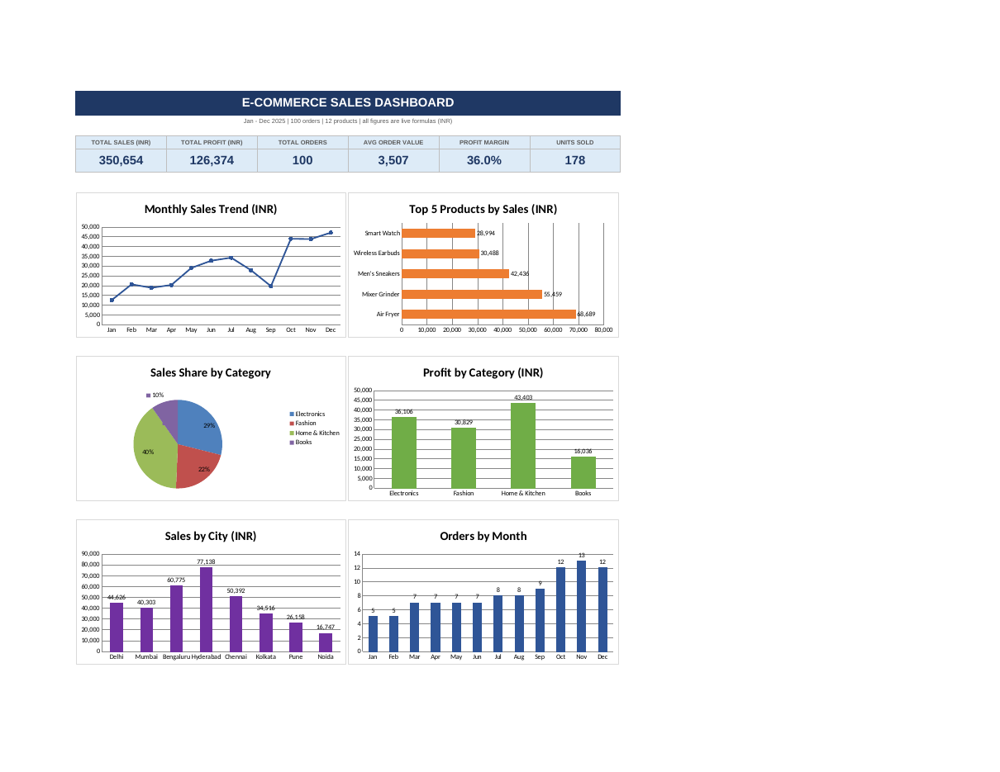

# E-commerce Sales Analysis (Excel)

A beginner-friendly Business Analyst project that analyses **100 online sales orders (Jan - Dec 2025)** and presents sales, profit, orders and product performance in an **Excel dashboard**.

> The dataset is **fictional** (generated for learning/portfolio use). Currency is Indian Rupees (INR).



## Business problem
An online store wants to know: *How much did we sell and earn? Which products and categories perform best? When are sales highest? Which cities and payment methods matter most?*

## Tools & skills
Microsoft Excel - formulas (SUM, SUMIF, COUNTIF, IF, RANK, INDEX/MATCH, MONTH, CHOOSE), Pivot-style summaries, PivotTable practice guide, charts, dashboard design, KPI analysis, trend analysis, business insights.

## Project structure
```
Project2_Ecommerce_Sales_Analysis/
|-- Ecommerce_Sales_Analysis.xlsx   <- main file (open this)
|-- data/sales_data_raw.csv         <- raw input data (100 orders)
|-- screenshots/dashboard.png
|-- docs/Project_Documentation.md   <- step-by-step explanation + insights
|-- docs/Interview_QA.md
|-- docs/Resume_Description.md
`-- README.md
```

## Workbook sheets
| Sheet | What it contains |
|---|---|
| Dashboard | 6 KPI cards + 6 charts |
| Sales_Data | 100 orders + calculated columns (Month, Sales, Total Cost, Profit, Profit Margin) |
| Analysis | Formula-based summaries: KPIs, monthly trend, products, categories, cities, payment methods, Top 5 / Bottom 3 |
| Pivot_Guide | Step-by-step guide to build the same tables with real PivotTables |

## Key results
- **Total sales INR 350,654**, **profit INR 126,374** (margin 36.0%), **100 orders**, average order value **INR 3,507**
- Top product by sales: **Air Fryer**; best-selling by units: **Python Programming Book** (48 units)
- Best month: **Dec**; Oct-Dec produced **38%** of annual sales
- Highest-sales category: **Home & Kitchen** (40% of sales); highest-margin category: **Books** (46.9%)

## How to use
1. Open `Ecommerce_Sales_Analysis.xlsx` in Excel and start at the **Dashboard** sheet.
2. Change any quantity, price or discount in `Sales_Data` - Sales, Profit and the dashboard update automatically.
3. Read `docs/Project_Documentation.md` for the full walkthrough.

## Note on PivotTables
The `Analysis` sheet contains *pivot-style summary tables built with formulas* so they always work. A `Pivot_Guide` sheet shows exactly how to create the matching real PivotTables in Excel.
